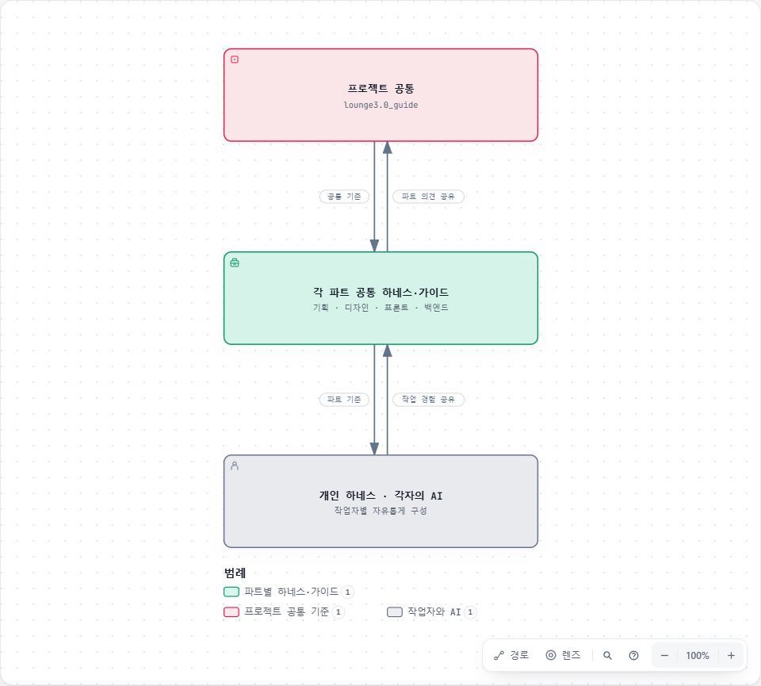

# 라운지 3.0 프로젝트 공통 가이드

AI가 요청을 이해하고 자료 확인·작업·검증·결과 정리를 진행하도록 돕는 프로젝트 공통 가이드입니다. 기획·디자인·프론트엔드·백엔드는 같은 문서 구조, 공용 스킬과 작성 형식을 사용합니다.

[공통 AI 작업 기준 브리핑](presentation.html)에서 만든 이유와 사용 방법을 짧게 확인할 수 있습니다. [브리핑 원본](presentation.md).

## 공통과 파트의 운영

프로젝트 공통 → 각 파트 공통 → 개인 하네스의 3단계로 운영합니다. 각 계층은 기준과 작업 경험을 주고받습니다.

- **프로젝트 공통:** 여러 파트가 함께 사용하는 AI 작업 원칙, 공용 스킬, 검증 기준과 참고 정보를 이 저장소에서 관리합니다.
- **각 파트 공통:** 담당 PL이 별도 저장소에서 파트의 하네스·가이드·상세 기준을 관리합니다. 자세한 내용은 해당 파트 저장소에서 확인합니다.
- **개인 하네스:** 작업자는 각자의 AI와 개인 하네스를 사용할 수 있습니다. 작업할 때 프로젝트 공통과 소속 파트의 공통 기준을 함께 확인합니다.

팀원은 공유할 개선 사항을 파트 PL과 논의합니다. 파트에서만 필요한 내용은 파트 저장소에 남기고, 여러 파트에 필요한 내용은 공통 관리자와 조율해 이 저장소에 반영합니다. 상세 절차는 [문서 관리 기준](project/maintenance.md#공통-기준의-반영-절차)을 따릅니다.

## 저장소 안내

| 구분 | 저장소 | 관리 담당 |
| --- | --- | --- |
| 공통 | [lounge3.0_guide](https://github.com/idtloungepmo/lounge3.0_guide) | 공통 관리자 |
| 기획 | 준비 중 | 기획 PL |
| 디자인 | [TLDS3.0](https://github.com/leemunhyoung/TLDS3.0) | 디자인 PL |
| 프론트엔드 | [lounge-docs](https://github.com/minsukong/lounge-docs) | 프론트엔드 PL |
| 백엔드 | 준비 중 | 백엔드 PL |

각 PL이 저장소 주소를 전달하면 공통 관리자가 이 표와 웹 시작 페이지의 바로가기를 갱신합니다. 파트별 문서의 현재 위치와 적용 범위는 각 저장소에서 확인합니다.

## AI 하네스 관계도

[](diagrams/ai-harness.html)

[애니메이션 관계도](diagrams/ai-harness.html) · [다이어그램 원본과 갱신 방법](diagrams/README.md)

화살표는 기준 공유와 작업 경험의 상호 교류를 나타냅니다. 애니메이션은 프로젝트 공통에서 파트 공통, 개인 하네스로 내려가는 기준의 흐름을 표시합니다. 의견 공유가 곧 기준 확정을 뜻하지는 않습니다.

## 시작하기

GitHub에서는 이 README에서 시작합니다. 웹 안내와 애니메이션은 저장소를 내려받아 **[index.html](index.html)**을 브라우저로 열어 확인합니다. GitHub의 HTML 파일 화면은 소스 보기이며 웹 게시 주소와 다릅니다. AI에는 [AGENTS.md](AGENTS.md)와 실제 파트 저장소의 작업 지침을 전달합니다.

AI에는 [AGENTS.md](AGENTS.md)와 작업 대상·자료·범위를 전달합니다. 처음 작업할 때는 루트 지침 → 프로젝트 지침과 기본 정보 → 실제 파트 저장소의 AGENTS.md → 필요한 원본 순서로 읽습니다. 작은 수정·작업 재개는 필요한 파트로 바로 이동합니다. 사람은 아래 정보 문서에서 시작해도 됩니다.

| 폴더 | 기본 정보 | 담는 내용 |
| --- | --- | --- |
| skills | [공용 스킬 안내](skills/AGENTS.md) | 여러 파트가 함께 사용하는 글쓰기 등 공용 지침 |
| templates | [HTML 템플릿](templates/index.html) · [사용법](templates/README.md) | 파트 시작 페이지와 개별 문서의 공통 형식 |
| assets | [공통 자원 안내](project/assets.md) | 공통 CSS·JS·이미지·파트 색상 자원 |
| diagrams | [다이어그램 안내](diagrams/README.md) | 독립 다이어그램 HTML·구조 원본·갱신 방법 |
| project | [프로젝트 정보](project/README.md) | 과업·기술 기준·영역·미확인 사항 |
| planning | [기획 저장소 안내](planning/README.md) | 파트 저장소 연결과 기본 구조 예시 |
| design | [디자인 저장소 안내](design/README.md) | 파트 저장소 연결과 기본 구조 예시 |
| frontend | [프론트엔드 저장소 안내](frontend/README.md) | 파트 저장소 연결과 기본 구조 예시 |
| backend | [백엔드 저장소 안내](backend/README.md) | 파트 저장소 연결과 기본 구조 예시 |
| collaboration | [협업 절차](collaboration/README.md) | 변경 영향·협의·결정·인수인계 |

문서 추가와 수정은 [문서 관리 기준](project/maintenance.md)을 따릅니다.

## 첫 요청 예시

```text
공통 가이드: <공통 가이드의 AGENTS.md 경로>
작업 대상: <실제 자료 또는 저장소 경로>
기준 자료: <파일·버전·화면 또는 슬라이드 범위>
공유 결정·작업 기록: <팀 위치 / 미정>
요청: <대상 기능과 기획 검토·설계·구현 등 이번 범위>

관련 파트의 AGENTS.md를 읽고 필요한 정보와 원본만 확인해줘.
확인한 사실·제안·미정을 나누고, 파트 간 영향과 실제 검증 결과를 남겨줘.
```

파트 저장소는 위 안내에서 선택합니다. 개인 PC의 작업 폴더와 기획서·업무 기록의 위치는 각 파트에서 확인합니다.

## 파트별 작성과 운영

각 파트의 내용·하위 구조·상세 지침은 담당 PL이 별도 저장소에서 구성합니다. 이 저장소의 planning/·design/·frontend/·backend/는 저장소 안내와 기본 구조 예시입니다. 실제 파트 문서의 별도 확정본을 이곳에 중복 관리하지 않습니다. 파트 문서가 생기면 해당 저장소의 AGENTS.md와 사람용 목차를 갱신하고, 공통 관리자는 전달받은 시작점 링크를 안내합니다.

사람용 HTML은 templates/에서 복사하고 assets/를 참조합니다. 문서 원본은 한 곳에서 관리하고, 다른 표현은 원본과의 관계를 표시합니다. 직접 작성하는 기준·안내는 Markdown 원본을 먼저 수정하고 사람용 HTML을 맞춥니다.

## 공통 문서 구조와 운영

[공통 문서 운영 기준](project/documentation.md) · [사람용 안내](project/documentation.html). 각 파트는 docs/ 아래에서 문서 역할과 사람과 AI의 시작 방식을 공통 기준에 맞춰 사용합니다. 내용·상세 목차·업무 절차·스킬은 각 PL이 정합니다. 파트 폴더의 기본 지침은 구성 예시이며, 실제 자료는 각 파트 저장소에서 관리합니다.

## AI 작업 가이드 심화

[심화 설명 원본](project/ai-context.md) · [사람용 심화 안내](project/ai-context.html). 기본 가이드의 구조와 작동 원리를 더 알고 싶은 분을 위한 자료입니다. 토큰·Attention·KV 캐시의 개념을 입력 관리·상태 영속화·원본 대조에 연결합니다. 필요한 자료 선별, 컴팩션 전 기록, 재개와 오류 정정 규칙을 확인합니다.

## 한국어 문서 작성

가이드·업무 문서·발표·브리핑은 [공용 글쓰기 스킬](skills/guides/korean-work-writing/SKILL.md)을 적용합니다. 제목은 내용을 바로 알 수 있게, 안내 본문은 차분한 ‘합니다’체로 작성합니다. 정책·책임·수치·승인 상태와 코드 예시는 문체를 다듬는 과정에서 바꾸지 않습니다.

## 기획서와 업무 기록

기획서와 향후 사용할 Redmine의 업무 기록은 각 원본에서 관리합니다. 이 가이드에는 AI의 작업 방법과 작성 기준을 두며, 기획 내용·이슈 상세·진행 상태를 별도 확정본으로 복제하지 않습니다. 실제 위치와 연동 방식은 추후 정리합니다.

## 파트별 워크플로우 구성과 코멘트

[파트별 워크플로우 구성 안내](collaboration/workflow.html) · [기획 보완 코멘트 — 사람·AI 공통 양식](collaboration/planning-comments.html). 각 PL은 공통 기준과 맷 포코크 원본 스킬을 참고해 파트에 맞는 흐름을 구성합니다. 프론트·백엔드는 기존 구성 예시만 짧게 안내하며, 상세 절차와 실제 사용할 스킬은 각 파트 저장소에서 관리합니다.

## 공용 스킬의 구분

[가이드 작성 스킬](skills/guides/AGENTS.md)은 가이드·브리핑 작성에, [개발 스킬](skills/development/AGENTS.md)은 실제 프로젝트의 기획 검토·설계·소스 작성·리뷰에 사용합니다.
