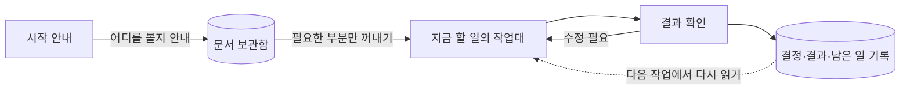
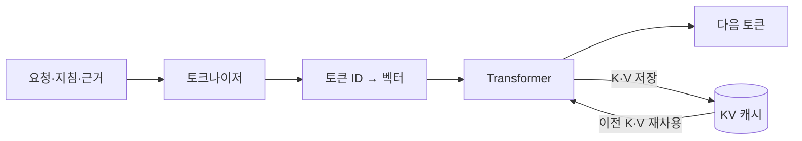
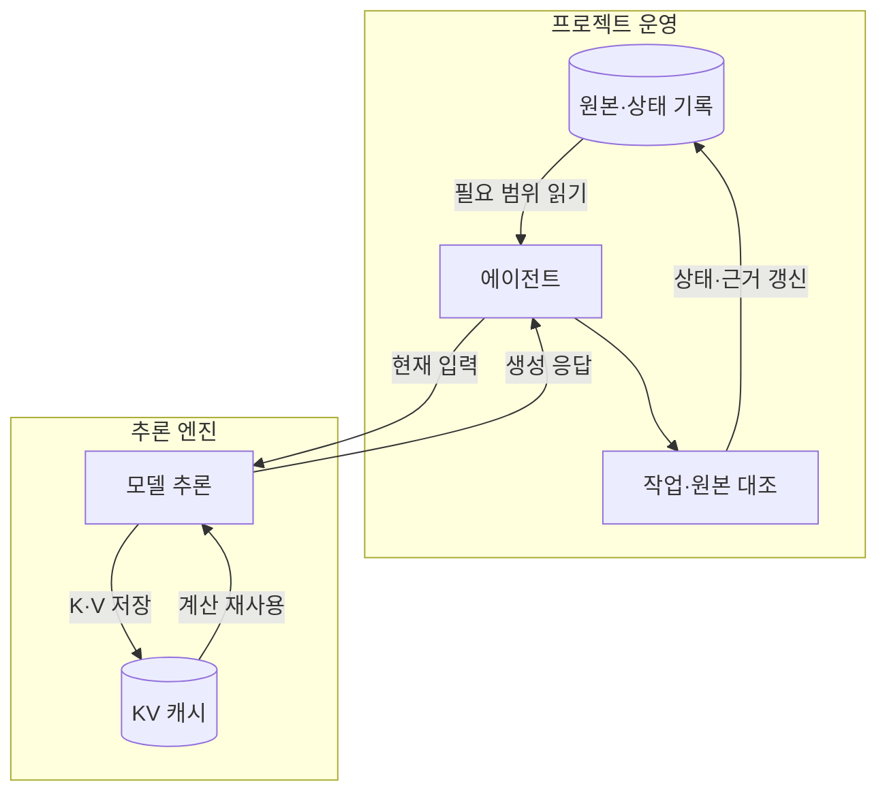
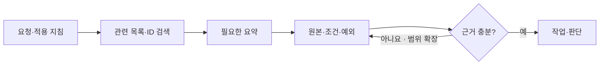
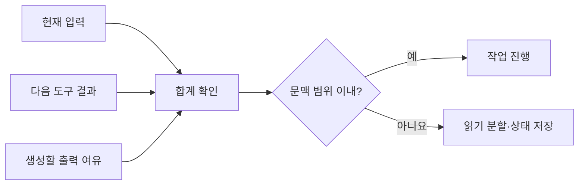
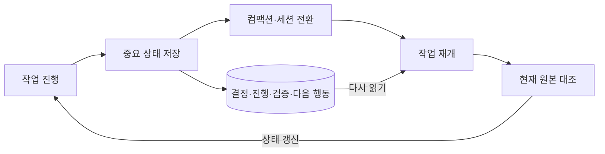
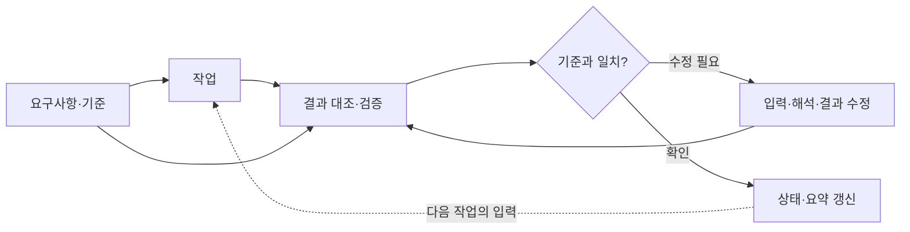
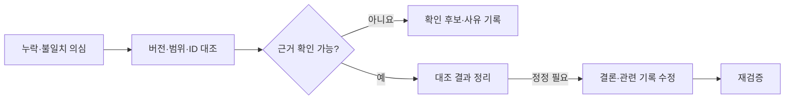

# AI 작업 가이드 심화

기본 가이드의 구조와 운영 방식이 왜 필요한지 더 알고 싶은 분을 위한 심화 자료입니다. 컨텍스트·작업 상태·검증의 원리를 설명하며, 처음에는 01절의 쉬운 설명부터 읽고 필요한 상세 내용을 선택해 확인합니다.

## 01. 먼저 쉽게 이해하기

AI가 일하는 모습을 **문서 보관함과 작업대**로 생각하면 쉽습니다. 프로젝트 문서는 보관함에 두고, 지금 할 일에 필요한 내용만 꺼내 작업대에 올립니다. AI가 현재 보고 처리하는 것은 이 작업대 위의 내용입니다.



필요한 자료를 꺼내 작업하고, 결과를 확인해 기록합니다. 다음 작업은 그 기록을 읽고 이어갑니다.

우리 가이드도 이 방식으로 구성합니다.

- **시작 안내:** 어떤 일을 할 때 어느 문서를 볼지 알려줍니다. AGENTS.md가 이 안내판 역할을 합니다.
- **상세 문서:** 필요한 기준과 설명을 보관합니다. 작업할 때 해당 부분을 찾아 읽습니다.
- **작업 기록:** 결정한 내용과 확인한 결과, 남은 일을 적어 둡니다. 다음 작업은 이 기록과 현재 자료를 함께 확인하고 이어갑니다.

작업대가 복잡해지면 지금 필요한 내용으로 정리하고, 중요한 결정과 남은 일은 기록에 남깁니다. 기록에 적힌 내용과 실제 결과가 맞는지도 서로 대조합니다.

**우리 하네스는 필요한 자료를 찾아 작업대에 올리고, 확인한 결과를 기록해 다음 작업으로 이어주는 구조입니다.**

여기까지가 전체 구조의 설명입니다. 아래부터는 이 방식이 필요한 기술적 이유와 구체적인 운영·검증 방법을 다룹니다. 원리가 궁금하거나 가이드를 관리하는 분이 필요한 부분을 이어 읽으면 됩니다.

### 상세 설명의 목적과 범위

AI 에이전트가 필요한 근거를 읽고, 작업을 이어가며, 결과를 원본과 대조할 수 있도록 입력과 작업 상태를 관리합니다. Cline과 로컬 LLM을 포함한 도구에 공통으로 적용하며, 도구별 기능과 실행 설정은 실제 환경에서 확인합니다.

개발자가 관리할 대상은 세 가지입니다. **이번 판단에 필요한 입력**, **다음 작업자가 복원할 상태**, **결과의 옳고 그름을 확인할 근거**입니다. 모델 내부 구조를 모두 알아야 운영할 수 있는 것은 아닙니다. 소프트웨어의 입력 계약, 상태 영속화, 의존성 관리, 검증과 같은 관점으로 접근합니다.

이 문서는 프로젝트 공통 운영 기준을 보완합니다. 실제 정책·일정·업무 상태는 각 원본에서 관리하고, 파트별 상세 절차와 기록 위치는 담당 PL이 관리합니다. 새로운 업무 원장이나 자동 연동을 지정하지 않습니다.

## 02. 개념과 아키텍처 비유



텍스트가 토큰 ID와 벡터로 변환된 뒤 Transformer를 거쳐 다음 토큰이 됩니다. 이전 K·V는 생성 과정에서 재사용합니다.

| 개념 | 의미 | 개발자가 이해할 비유 | 운영에서 할 일 |
| --- | --- | --- | --- |
| 토크나이저 | 텍스트를 모델이 처리하는 토큰 ID의 열로 변환합니다. 단어·글자·토큰은 일대일 대응하지 않습니다. | 문자열을 처리 단위로 나누는 입력 변환 계층 | 실제 사용하는 모델의 토크나이저로 입력량을 확인합니다. |
| 토큰 효율 | 필요한 의미와 근거를 유지하면서 불필요한 입력·출력을 줄이는 정도입니다. | 요청에 필요한 필드만 보내는 API 설계 | 중복과 무관한 내용을 줄이고 ID·조건·예외는 보존합니다. |
| Transformer | Attention과 토큰별 변환 등을 여러 층으로 쌓아 입력 표현을 처리하는 모델 구조입니다. | 참조 정보를 섞고 변환하는 단계별 처리 파이프라인 | 지침·근거·작업 요청을 구분해 제공합니다. |
| Attention | 토큰 표현 사이의 관련도를 계산해 정보를 가중 결합합니다. | 현재 처리에 필요한 정보를 동적으로 참조하는 연산 | 관련 근거를 선별하되, 읽혔다는 사실을 올바른 판단의 보장으로 보지 않습니다. |
| KV Cache | 생성 중 이전 토큰의 Key·Value 중간 계산 결과를 저장해 재사용합니다. | 실행 엔진의 중간 계산 캐시 | 엔진 설정과 실제 메모리·지연을 측정합니다. |
| 컨텍스트 윈도우 | 모델이 한 번의 처리에서 다룰 수 있는 토큰 범위입니다. | 한 번의 요청에서 사용할 수 있는 작업 공간의 상한 | 입력뿐 아니라 출력과 다음 도구 결과를 위한 여유도 확보합니다. |
| 컴팩션 | 이전 대화의 일부를 요약 등으로 대체해 활성 컨텍스트를 줄이는 과정입니다. | 손실이 있을 수 있는 작업 스냅샷 | 중요한 결정·근거·진행 상태를 별도로 남기고 재개 시 확인합니다. |
| 문서 기반 외부 상태 | 결정·진행·근거·검증 결과를 파일이나 지정 업무 기록에 보존합니다. | 데이터베이스·체크포인트·변경 이력 | 현재 상태와 이력을 구분하고 원본 참조를 유지합니다. |

비유는 관리 책임을 이해하기 위한 것입니다. Attention은 데이터베이스의 정확 일치 조회가 아니며, 외부 문서를 저장하는 것만으로 모델이 내용을 자동으로 알게 되지는 않습니다. 필요한 내용을 도구로 읽어 현재 입력에 넣어야 합니다.

토큰은 모델의 어휘와 분할 방식에 따라 달라집니다. 한국어·영어·코드·식별자의 토큰 수를 글자 수로 일정하게 환산하지 않습니다. BPE·Unigram·WordPiece 등은 서로 다른 분할 방식을 사용합니다. [토큰화 공식 설명](https://huggingface.co/docs/transformers/en/tokenizer_summary)

Transformer의 Attention은 Q(Query)와 K(Key)의 관련도를 바탕으로 V(Value)를 결합합니다. Q·K·V는 학습된 벡터이며 업무 문서의 제목·키·본문과 직접 대응하는 필드가 아닙니다. 현재 널리 쓰이는 생성형 LLM은 주로 앞선 토큰을 참조하는 방식으로 다음 토큰을 만듭니다. [Transformer 원 논문](https://arxiv.org/abs/1706.03762)

## 03. KV 캐시 최적화와 문서 기반 상태 관리

두 방식은 서로 다른 계층에서 작동합니다. 필요한 자료를 선별해 실제 입력을 줄이면 추론 부담도 줄어들 수 있지만, 문서를 나누는 작업 자체가 엔진의 KV 캐시 구현을 최적화하는 것은 아닙니다.



위쪽은 근거·작업 상태를 관리하는 흐름이고, 아래쪽은 현재 입력의 계산을 재사용하는 흐름입니다.

| 비교 | KV 캐시 최적화 | 문서 기반 상태 관리 |
| --- | --- | --- |
| 관리 계층 | 모델 추론 엔진 | 에이전트·프로젝트 운영 |
| 저장 대상 | 토큰별 K·V 텐서 | 사람이 읽을 수 있는 근거·결정·진행·검증 기록 |
| 목적 | 계산 재사용, 메모리와 지연 관리 | 재개·인수인계·원본 추적·오류 수정 |
| 주요 수단 | 캐시 양자화·오프로딩·페이지 관리 등 | 문서 목록·요약·상태 기록·식별 ID·변경 이력 |
| 수명과 재사용 | 엔진·세션·접두부 일치·보존 정책 등에 좌우 | 지정된 저장 위치에 보존하고 필요할 때 다시 읽음 |
| 보장하지 않는 것 | 정책의 정확성, 영구적인 업무 기억 | 읽지 않은 자료의 자동 인지, 계산 캐시 적중 |

**KV 캐시가 해주는 일.** 이전 K·V를 재사용하므로 새 토큰을 만들 때 그 부분의 재계산을 줄입니다. 새 토큰이 이전 문맥을 참조하는 계산까지 없어지는 것은 아닙니다. 일반적인 전체 Attention에서는 실제 문맥이 길어질수록 캐시 메모리와 참조 비용도 커집니다. 입력을 처음 처리하는 단계(prefill)와 이후 토큰을 생성하는 단계(decode)를 나눠 봅니다. [KV 캐시 동작](https://huggingface.co/docs/transformers/en/cache_explanation)

**엔진에서 조절하는 일.** 양자화는 저장 정밀도를 줄이고, 오프로딩은 저장 위치를 옮기며, 페이지 관리는 메모리 할당 낭비를 줄입니다. GQA는 여러 Query 헤드가 K·V를 공유하는 모델 구조입니다. 방법별 지원 여부·정확도·속도 효과가 다르므로, 메모리 절약을 곧 속도 향상으로 간주하지 않습니다. 설정한 최대 컨텍스트와 실제 입력 길이도 구분합니다. 정적 사전 할당과 동적 할당은 메모리 사용 양상이 다릅니다. [캐시 전략 공식 설명](https://huggingface.co/docs/transformers/en/kv_cache)

**프롬프트 캐싱과의 관계.** 일부 서비스는 요청 사이에서 동일한 접두부의 계산을 재사용합니다. 지원 제품의 캐시 적중·무효화·보존 조건을 확인합니다. 안정된 공통 지침과 변경되는 작업 자료를 구분하는 것은 도움이 될 수 있지만, 적중을 위해 오래된 근거를 유지하지 않습니다. 캐시된 입력도 문맥 길이에서 사라지는 것은 아닙니다. [프롬프트 캐싱 공식 설명](https://platform.claude.com/docs/en/build-with-claude/prompt-caching)

**문서 상태가 해주는 일.** 대화나 캐시가 사라져도 다음 작업자가 같은 원본과 결정을 찾아 작업을 복원하게 합니다. 이 문서를 읽는 일에는 다시 토큰과 계산이 듭니다. 목적은 무조건적인 속도 향상보다 재현 가능한 작업과 검증 가능한 판단입니다.

## 04. 필요한 자료 선별과 토큰 관리

자료는 **요청 → 적용 지침 → 관련 문서 목록 → 필요한 요약 → 판단에 필요한 원본 범위** 순서로 좁혀 읽습니다. 적용되는 지침을 생략하거나, 요약만으로 결론을 정하는 절차로 사용하지 않습니다.



적용 지침을 유지한 채 필요한 자료로 좁혀 읽고, 근거가 부족하면 원본 확인 범위를 넓힙니다.

1. 목표·대상·완료 조건을 확인합니다. IA 비교라면 대상 플랫폼·화면 범위·비교 버전을 먼저 정합니다.
2. 적용되는 AGENTS.md와 선택한 스킬의 필수 지침을 확인합니다. 링크된 문서를 전부 읽으라는 의미로 해석하지 않습니다.
3. 파일명·제목·화면 ID·업무 ID로 관련 자료를 찾습니다. 식별자가 있으면 의미 검색보다 정확 일치 검색을 먼저 사용합니다.
4. 해당 절·행·화면과 의미를 결정하는 주변 설명·공통 조건을 읽습니다. 검색 결과의 한 줄만으로 정책을 판단하지 않습니다.
5. 결론에 영향을 주는 정의·조건·예외는 원본과 대조합니다. 불일치하거나 범위가 부족하면 필요한 자료를 추가합니다.
6. 큰 출력은 파일에 보존하고 현재 판단에 필요한 부분만 읽습니다. 잘린 출력은 전체 확인으로 표시하지 않습니다.

**입력에서 줄일 내용:** 같은 내용의 Markdown과 HTML 중복 읽기, 무관한 과거 대화, 전체 빌드 로그의 반복 첨부, 이번 범위와 관계없는 명세, 이미 읽은 파일의 이유 없는 반복 읽기.

**줄이면서도 보존할 내용:** 원본 위치·버전·식별 ID, 적용 조건과 예외, 확정·제안·미정의 차이, 사용자 결정, 재현에 필요한 입력과 오류 메시지. 영어로 바꾸거나 축약어를 늘리는 것만을 토큰 절감 규칙으로 삼지 않습니다.

컨텍스트 예산은 다음 항목을 함께 봅니다.

```text
적용 지침 + 사용자 요청 + 유지할 대화·상태 + 선택한 근거
+ 도구 정의·도구 결과 + 생성할 출력 여유 ≤ 실제 사용 가능한 문맥 범위
```



현재 입력뿐 아니라 다음 도구 결과와 생성할 출력까지 고려합니다. 도식의 배분 비율은 개념 예시입니다.

도구·서비스마다 숨은 입력, 출력 상한, 추론 토큰의 집계 방식이 다릅니다. 실제 사용량 표시와 해당 환경의 제한을 확인합니다. 예를 들어 사용 가능 범위가 32K인 환경에서 현재 입력이 24K이고 다음 결과가 6K, 출력이 4K로 예상되면 그대로 진행하지 않고 읽기 범위를 나누거나 상태를 저장한 뒤 재구성합니다. 이 수치는 계산 예시이며 팀 공통 임계값이 아닙니다.

입력 길이 상한이 곧 근거 활용의 정확도를 뜻하지는 않습니다. 장문 안에서 근거의 위치에 따라 성능이 달라진 연구가 있습니다. 이를 모든 최신 모델에 동일하게 적용하지 않고, 팀의 실제 과제로 평가합니다. 목표·핵심 제약·관련 근거를 찾기 쉽게 구성합니다. [장문 문맥 활용 연구](https://arxiv.org/abs/2307.03172)

문서가 많아지면 검색·임베딩 기반 검색(RAG)을 추가할 수 있습니다. 검색은 필요한 자료를 찾아 입력에 넣는 수단입니다. 결정 승인·진행 상태·오류 정정까지 자동으로 관리하지는 않습니다. 검색 인덱스의 갱신 여부와 원본 버전도 확인합니다.

## 05. 문서 기반 외부 상태와 컴팩션

장기 작업은 **업무 원본 / 현재 상태 / 변경 이력 / 다음에 읽을 안내**를 구분합니다. 별도 파일을 반드시 네 개 만들라는 뜻은 아닙니다. 기존 기록에서 역할이 구분되면 충분합니다.



컴팩션·세션 전환 전에 중요한 상태를 저장하고, 재개할 때 기록과 현재 원본을 함께 확인합니다.

| 역할 | 보존할 내용 | 관리 규칙 |
| --- | --- | --- |
| 업무 원본 | 기획·계약·디자인·소스·지정 업무 기록 | 정책과 업무 상태는 해당 원본에서 확인합니다. |
| 현재 상태 | 목표·완료 범위·남은 일·검증·미확인 | 과거 계획을 현재 사실로 남기지 않고 갱신합니다. |
| 변경 이력 | 결정·정정의 전후·이유·근거 | 기존 오류의 정정 사실과 후속 기준을 추적할 수 있게 남깁니다. |
| 문서 목록·요약 | 파일 역할·읽을 상황·원본 참조 | 원본 변경 시 요약의 적용 조건과 링크도 갱신합니다. |

작업 단위가 끝났을 때, 중요한 결정이나 오류 수정이 생겼을 때, 컴팩션·세션 전환·인수인계 전에는 다음 항목을 남깁니다. 작은 수정은 결과 보고에 포함하고 별도 장문 기록을 만들지 않습니다.

```text
목표·범위·완료 조건:
기준 원본: 위치 / 버전·커밋 또는 확인 시점 / 화면·노드·업무 ID
현재 결정: 확정·제안·미정 / 결정 근거
완료: 실제 변경한 대상과 범위
검증: 방법 / 환경·대상 버전 / 실제 결과 / 결과 자료 위치
미확인·남은 문제: 판단이나 추가 확인이 필요한 부분
정정: 이전 판단 → 수정 판단 / 근거 / 영향받는 기록
다음 행동: 첫 번째 작업 / 먼저 다시 읽을 원본
```

**컴팩션은 대화 입력을 줄이는 과정입니다.** 요약에서 조건·예외·오류 정정이 빠질 수 있으므로 완전한 보존으로 취급하지 않습니다. 문서 기반 상태는 컴팩션 여부와 별개로 유지합니다. Cline의 자동 요약·절단 동작은 버전·모델·제공자에 따라 확인하고, 요약이 항상 실행된다고 가정하지 않습니다. [Cline Auto Compact](https://docs.cline.bot/features/auto-compact)

재개할 때는 목표·결정·미완료·검증 결과를 먼저 읽고, 현재 파일과 원본의 변경 여부를 확인합니다. 요약과 원본이 다르면 원본의 적용 범위와 승인 근거를 확인한 뒤 상태와 관련 파생 문서를 정정합니다. 문서로 기록된 이전 성공도 현재 버전의 성공을 자동으로 보장하지는 않습니다.

## 06. 작업과 검증의 피드백 구조

작업과 검증을 분리하고, 기준·결과·기록을 서로 대조합니다. 작업 결과가 요구사항을 충족하는지 확인하고, 문서에 남긴 상태가 실제 결과와 일치하는지도 확인합니다.

차이가 발견되면 입력 자료나 해석, 작업 결과 중 어디에서 발생했는지 살펴봅니다. 해당 부분을 수정한 뒤 다시 검증하고, 바뀐 결과를 요약과 작업 상태에 반영합니다.



기준과 결과를 대조하고, 차이를 수정·재검증한 뒤 다음 작업에 반영합니다.

이 과정은 결과를 다음 작업의 입력으로 되돌리는 피드백 구조입니다. 문서 기반 상태 관리는 확인된 결과와 남은 일을 다음 작업에 전달해, 세션이 바뀌어도 검증과 수정을 이어가게 합니다.

## 07. 원본 대조와 검증

검토 결과는 다음과 같이 구분합니다. ‘확정·현행 확인·제안·미정·미확인·대체됨’의 상태 정의는 [문서 관리 기준](maintenance.md)을 따릅니다.

| 구분 | 작성 예 | 필요한 근거 |
| --- | --- | --- |
| 원본 관찰 | 지정 화면에서 해당 문구를 확인했습니다. | 원본 위치·버전 또는 확인 시점·ID·범위 |
| 전달받은 설명 | 담당자가 해당 방향으로 설명했습니다. | 발언·기록 출처와 일자. 승인 여부는 별도 확인 |
| 해석·영향 추론 | 이 조건이면 복귀 흐름 변경이 필요할 수 있습니다. | 관찰 근거와 판단에 사용한 조건 |
| 확인 후보 | 해당 상태의 처리 기준을 추가 확인해야 합니다. | 현재 자료에서 불명확한 부분과 필요한 질문 |
| 실제 검증 | 지정 환경에서 해당 시나리오를 실행해 결과를 확인했습니다. | 환경·대상 버전·입력·기대 결과·실제 결과 |

### 누락·불일치 판단



근거를 확인할 수 없으면 후보로 남기고, 대조 결과에 따라 결론을 정리합니다. 정정한 결과는 다시 검증합니다.

1. 어느 버전의 무엇을 비교하는지 정합니다. 화면 목록·작업 목록·구현 상태를 섞지 않습니다.
2. ID와 이름을 함께 대조하고 변경된 이름·중복·별칭·제외 범위를 확인합니다.
3. 검색 실패, 문서 추출 실패, 출력 잘림, OLD 제외, 작성 중·보류를 실제 누락과 구분합니다.
4. 발견한 차이는 근거와 함께 기록합니다. 원본 접근이 막히면 확정 대신 확인 후보로 남깁니다.
5. 오류가 확인되면 현재 결론을 고치고 정정 이유·근거를 이력에 남깁니다. 관련 요약·체크리스트·파생 문서도 갱신합니다.

### 결과 확인

문서 검토, 코드 검사, 실행 결과, 화면 직접 확인은 서로 다른 증거입니다. 테스트 성공을 화면 검수 완료나 운영 반영으로 확대하지 않습니다. 예를 들어 Storybook의 응답 성공은 해당 화면의 시각적 정확성이나 운영 배포를 입증하지 않습니다. 기대 동작과 실제 결과를 비교하고, 오류 수정 후에는 해당 실패를 재현하던 조건으로 다시 확인합니다.

검증 범위는 변경 영향에 맞춥니다. 완료한 검사와 남은 확인을 짧게 보고하고, 실행하지 않은 항목에 완료 표시를 하지 않습니다.

## 08. 팀 공통 운영 규칙

1. **시작:** 목표·범위·완료 조건과 적용 지침을 확인합니다.
2. **읽기:** 관련 목록에서 필요한 문서를 선택하고, 판단에 필요한 원본·조건·예외를 읽습니다.
3. **입력 관리:** 중복·무관한 자료와 큰 출력의 반복 투입을 줄이고 다음 결과·출력 여유를 확보합니다.
4. **판단:** 원본 관찰·전달받은 설명·추론·미확인을 구분합니다.
5. **기록:** 중요한 결정·진행·근거·검증·다음 행동을 지정 기록에 남깁니다.
6. **재개:** 컴팩션·세션 전환 뒤에는 기록과 현재 원본을 확인해 상태를 복원합니다.
7. **검증:** 완료 조건에 맞춰 원본과 결과를 대조하고 실제 실행한 범위만 완료로 표시합니다.
8. **정정:** 오류를 수정하면 현재 결론과 관련 파생 기록을 함께 고치고 이력을 남깁니다.

에이전트에 전달할 때는 아래 요청문에서 필요한 항목만 사용합니다.

```text
공통·파트 지침: <경로>
목표·대상·이번 범위: <내용>
완료 조건: <확인할 결과>
기준 원본: <위치·버전·식별 ID·범위>
이전 상태·업무 기록: <위치 또는 없음>

적용 지침을 확인하고 이번 판단에 필요한 자료만 읽어줘.
관찰·전달받은 설명·추론·미확인을 구분하고,
누락·불일치 후보는 원본의 ID와 조건을 대조해줘.
중요한 상태는 기존 기록에 남기고, 실제 검증 결과와 다음 행동을 정리해줘.
```

## 09. 하네스 검증과 운영 효과 확인

### 하네스와 가이드 자체의 검증

하네스와 가이드를 변경하면 문서 구조와 실제 작업 행동을 함께 확인합니다. 구조 점검은 필요한 기준을 찾고 적용할 수 있는지, 행동 검증은 그 기준에 따라 작업하는지 확인합니다.

**문서 구조 점검**

| 확인 대상 | 확인할 내용 |
| --- | --- |
| 시작점과 문서 선택 | 요청 종류에 따라 필요한 지침·자료로 이동할 수 있는지 확인합니다. 가이드가 작업 저장소 밖에 있으면 실제 사용 도구에 시작점을 전달하는 방법도 확인합니다. |
| 링크와 적용 범위 | 파일·자원·절 링크가 유효하고, 각 지침의 적용 대상과 읽을 상황이 분명한지 확인합니다. |
| 기준의 일관성 | 상위·하위 지침의 충돌, 중복된 규칙의 차이, 오래된 요약이나 폐기된 안내가 남아 있는지 확인합니다. |
| 원본과 표현 | Markdown·HTML·다이어그램이 같은 의미를 전달하고, 요약에서 조건·예외가 빠지지 않았는지 확인합니다. |

파일·링크·내용 일치처럼 반복 가능한 항목은 자동 검사로 확인할 수 있습니다. 지침의 의미와 적용 범위는 관련 문서를 함께 읽고 검토합니다.

**대표 과제로 행동 확인**

아래 상황에서 변경한 규칙과 관련된 과제를 선택합니다. 기대 행동을 먼저 정하고, 최종 답변과 자료 읽기·도구 실행·변경 기록을 함께 대조합니다. 실제 업무에서 확인한 사례도 사용할 수 있으며, 같은 조건을 다시 확인할 수 있도록 요청과 입력 범위를 남깁니다.

| 시험 상황 | 기대하는 행동 |
| --- | --- |
| 작은 범위의 수정 | 적용 지침과 관련 자료를 선택하고 요청 범위 안에서 수정합니다. |
| 요약과 원본의 불일치 | 차이를 발견하고 적용 기준을 확인한 뒤 결과와 관련 기록을 갱신합니다. |
| 새 세션에서 작업 재개 | 상태 기록을 읽고 현재 원본과 대조해 완료·미완료를 구분하고 이어갑니다. |
| 자료 일부 누락·추출 범위 제한 | 확인 범위를 밝히고 추가 대조가 필요한 부분을 남깁니다. |
| 일부 검사 성공·일부 미실행 | 실제 확인한 범위만 완료로 보고하고 남은 검증을 구분합니다. |

AI의 설명과 실제 행동이 일치하는지 확인합니다. 지침을 읽었다거나 검증했다고 답한 사실만으로 통과 처리하지 않습니다. 사용 도구에서 읽기·실행 기록을 확인할 수 없다면 그 부분은 미확인으로 남깁니다.

**변경 후 재검증과 결과 기록**

지침·문서 연결·요약·스킬 또는 사용 도구의 동작이 바뀌면 영향받는 대표 과제를 다시 확인합니다. 작은 수정에 모든 과제를 반복하지 않습니다. 중요한 행동은 필요에 따라 새 세션에서 반복해 일관성을 확인합니다.

예상과 다른 행동이 나오면 지침 누락·충돌, 자료 선택, 도구의 지침 적용 방식, 작업 상태 전달 중 어디에서 차이가 생겼는지 확인합니다. 해당 부분을 수정하고 같은 조건으로 재검증합니다. 새 작업자가 추가 구두 설명 없이 필요한 기준을 찾아 작업을 이어갈 수 있는지도 확인합니다.

기존 작업 기록에 **가이드 기준 버전 또는 확인 시점 / 모델·도구·설정 / 요청·입력 범위 / 기대 행동 / 실제 행동과 확인 기록 / 확인한 범위·미확인 사항 / 수정·재검증 결과**를 필요한 만큼 남깁니다. 한 번의 성공을 모든 과제·모델·환경의 검증 완료로 확대하지 않습니다.

### 운영 효과 측정

같은 모델·엔진·설정·과제·기준 자료를 고정하고 자료 선별 전후를 비교합니다. 캐시가 없는 첫 실행과 캐시를 재사용한 실행도 구분합니다. 토큰 수만 줄고 근거·예외가 빠졌다면 개선으로 판단하지 않습니다.

| 확인 대상 | 기록할 내용 |
| --- | --- |
| 입력 효율 | 실제 입력·출력 토큰, 읽은 자료 범위, 반복 읽기 |
| 추론 성능 | 첫 응답 지연, 생성 속도, 실제 문맥 길이, GPU·시스템 메모리 |
| 재개 품질 | 다음 작업자가 찾은 기준과 결정, 누락된 상태, 잘못 반복한 작업 |
| 검증 품질 | 잘못된 누락 판단, 원본 대조로 정정한 항목, 미검증 완료 표시 |

측정 결과에는 모델·도구·설정·캐시 상태·확인 시점을 남깁니다. 기존 작업 기록만으로 토큰 절감률·속도 향상률을 만들어 제시하지 않습니다.

## 10. 관련 기준과 참고 자료

- [공통 문서 운영 기준](documentation.md): 문서 역할, 사람과 AI의 시작점, 필요한 자료 선택
- [문서 관리 기준](maintenance.md): 상태 정의와 원본·HTML 갱신
- [파트별 워크플로우 구성](../collaboration/workflow.md): 파트 PL의 상세 절차와 스킬 구성
- [협업 절차](../collaboration/README.md): 변경 영향과 인수인계
- [토큰화 공식 설명](https://huggingface.co/docs/transformers/en/tokenizer_summary)
- [Transformer 원 논문](https://arxiv.org/abs/1706.03762)
- [KV 캐시 동작](https://huggingface.co/docs/transformers/en/cache_explanation) · [캐시 전략](https://huggingface.co/docs/transformers/en/kv_cache)
- [프롬프트 캐싱 공식 설명](https://platform.claude.com/docs/en/build-with-claude/prompt-caching)
- [Cline Auto Compact](https://docs.cline.bot/features/auto-compact)
- [장문 문맥 활용 연구](https://arxiv.org/abs/2307.03172)

기술 자료는 2026-11-09에 확인했습니다. 제품별 동작은 설치 버전과 실제 실행 환경에서 다시 확인합니다.
